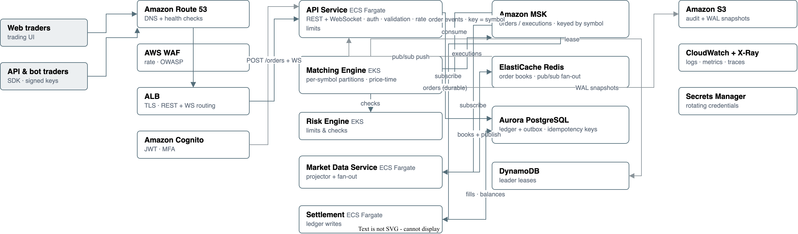

# Problem 1: Building Castle In The Cloud

A highly available, scalable, cost-effective trading system on AWS, designed
against the reference feature set of Binance.

**Constraints:** AWS only · 500 requests/s throughput · p99 response time < 100ms

## 1. Scope — features chosen and why

A full exchange (custody, futures, margin, staking, P2P) cannot be covered in
this exercise. The design covers the slice that best demonstrates cloud
infrastructure mastery and that carries the hardest requirements:

| Feature | Why it was chosen |
|---|---|
| Order entry (REST) | The 500 rps / p99 < 100ms constraint lives here; shows throttling, validation, idempotency, async decoupling |
| Matching engine | The heart of an exchange; demonstrates stateful workloads, partition placement, failover, event sourcing |
| Market data (WebSocket) | Shows push/fan-out architecture and connection-heavy scaling |
| Trade & order ledger (PostgreSQL) | Shows ACID data tier, backups, read scaling |
| Audit stream (S3) | Shows cost-effective compliance-grade storage |

**Out of scope** (product features, not infra): wallet custody, fiat rails,
KYC/AML, margin/futures, marketing site, CI/CD (that is Problem 4).

## 2. Workload assumptions

`500 rps` is the sustained peak at the edge, split as follows. These numbers
drive every sizing decision below.

| HTTP request type | RPS | Examples |
|---|---:|---|
| Public reads | 180 | Summary, book snapshot, recent trades (served from Redis) |
| Trading writes | 125 | Place order, cancel order |
| Private reads | 75 | Open orders, order history, balances |
| Auth and metadata | 70 | Login, token refresh, trading rules |
| WebSocket connect/reconnect | 50 | Initial connection or reconnect |
| **Total** | **500** | Sustained peak |

Additional load assumptions:

- **WebSocket fan-out:** 10,000 concurrent connections; up to 100,000
  messages/s outbound, coalesced to ≤10 updates/s per connection.
- **Reconnect storm:** 500 new WebSocket connections/s for 5 minutes (deploy,
  regional blip) — the system must survive this without dropping established
  sessions.
- **Burst envelope:** 3× sustained peak for up to 5 minutes; intake sheds load
  gracefully beyond that instead of collapsing.
- **Freshness targets:** book/trade updates within 250 ms; candles within 2 s.

## 3. API design

### Endpoints

| Endpoint | Purpose | Success |
|---|---|---|
| `POST /api/v1/orders` | Place order (with `Idempotency-Key`) | `202 Accepted` + order id |
| `DELETE /api/v1/orders/{id}` | Cancel open order | `202 Accepted` |
| `GET /api/v1/orders` | Open orders (cursor-paginated) | `200` |
| `GET /api/v1/orders/{id}` | Order status + fills | `200` |
| `GET /api/v1/trades/{symbol}` | Public recent trades | `200` (Redis) |
| `GET /api/v1/book/{symbol}` | Order book snapshot | `200` (Redis) |
| `WS /ws/stream` | Subscribe to depth/trades/ticker per symbol | push |

### Order model and lifecycle

`POST /orders` body: `symbol`, `side` (BUY/SELL), `type` (LIMIT/MARKET),
`price`, `quantity`, `timeInForce` (GTC/IOC/FOK). Lifecycle:
`NEW → PARTIALLY_FILLED → FILLED | CANCELLED | EXPIRED | REJECTED`.

### The order contract — durable before ack

1. Client sends the order with an `Idempotency-Key` (client-generated UUID).
2. The API Service authenticates (JWT / signed bot key) and validates the
   request against trading rules (price bands, lot sizes, symbols).
3. The order is written **durably** to Aurora in one transaction together with
   an outbox record, keyed by idempotency key. A retried or replayed request
   returns the *same* order — no double order, no duplicate trade.
4. A background publisher streams the outbox record to MSK.
5. The API returns `202 Accepted` with the order id. **Fills are not part of
   the HTTP response** — they arrive asynchronously on the WebSocket stream
   (or by polling `GET /orders/{id}` for non-WS clients).

`202` means "durably accepted", never "executed". The p99 budget (§7) is for
this path only.

### Authentication and rate limiting

- **Users:** JWT issued by Cognito (MFA); `Authorization: Bearer`.
- **Bots:** API key + HMAC signature over timestamp + nonce (replay window
  ±30 s), so keys never travel in headers alone.
- **Rate limits:** AWS WAF applies coarse per-IP limits at the ALB; the API
  Service enforces per-user/per-key token buckets in Redis (e.g. 20 orders/s,
  50 reads/s per principal) → `429` + `Retry-After`.
- **Overload behaviour:** when MSK lag or Aurora saturation crosses a
  threshold, the exchange rejects new orders with `503` + `Retry-After`
  instead of queueing them into an unbounded backlog.

### WebSocket protocol

- Subscribe per symbol: `{"op": "subscribe", "symbols": [...]}`.
- **Snapshot-then-delta:** on subscribe, the client receives a book snapshot
  with sequence number `N`, then deltas `N+1, N+2, …`. A gap in sequence
  numbers triggers a client resubscribe (server detects slow consumers and
  disconnects them instead of buffering unboundedly).
- Heartbeat every 15 s; reconnect with exponential backoff + session resume
  (last sequence number), so a reconnect storm degrades to snapshot reads,
  never to stale books.
- Versioned: `/ws/stream?protocol=1`; additive protocol changes only.

## 4. Queuing system

### Topics and partitioning

| Topic | Key | Purpose |
|---|---|---|
| `trading.orders.v1` | `symbol` | Intake → matching engine (strict per-symbol order) |
| `trading.executions.v1` | `symbol` | Fills/trades → market data, settlement, audit |
| `trading.dlq.v1` | `symbol` | Poison events (schema errors, orphaned cancels) |

- **32 partitions initially.** Each hot symbol gets its own partition;
  long-tail symbols share partitions by consistent hash. The partition count
  is the matching parallelism ceiling — one consumer per partition, because
  **one symbol = one writer**, ever.
- Retention: 7 days on both topics (delete policy); book rebuild uses S3
  snapshots (hourly) + partition replay from the snapshot's offset, so
  recovery is minutes, not a full replay.

### Delivery semantics

- **Ordering:** strict per-key (per-symbol) ordering — the foundation of
  deterministic matching. No cross-key ordering is needed or promised.
- **Delivery:** at-least-once. Every consumer is idempotent: the matching
  engine dedupes by `orderId`, settlement by `executionId`, the market-data
  projector overwrites by sequence number. Idempotency is enforced by unique
  constraints in Aurora, not by memory.
- **Producer path:** `acks=1` with bounded retries; the API never blocks
  clients on broker slowness — the outbox publisher drains asynchronously and
  the intake rejects (503) only if the outbox itself backs up.

### Consumer groups — isolation is the point

| Group | Members | Failure mode if lagging |
|---|---|---|
| `matching` | 1 per partition (static) | Order execution slows — intake sheds load |
| `market-data` | 3+ | Public data lags; trading unaffected |
| `settlement` | 3+ | Ledger eventually-consistent; trading unaffected |
| `audit` | 2 | Audit export lags; nothing else |

Fan-out consumers (market data, settlement, audit) can never stall the
matching engine: they lag in their own groups, and matching keeps consuming.
**Consumer lag is the scaling signal** — matching autoscales on its group's
lag, the projector on its own.

### Backpressure, replay, dead letters

- **Backpressure:** bounded outbox table + lag alarms; when the log is
  saturated, refuse intake early (503) — this is the layer that converts a
  traffic spike into shed load instead of a collapse.
- **Replay:** a matching-engine standby rebuilds its book by loading the last
  S3 snapshot and replaying `orders` + `executions` from the recorded offset.
  No live state replication between matching hosts is required.
- **Dead letters:** events that fail validation N times go to `trading.dlq.v1`
  with an alarm; operators inspect and replay (with a tool) — never silently.

### Why MSK

Per-key ordering + replayable offsets + independent consumer groups are the
hard requirements. SQS (even FIFO) has no offset-based replay; Kinesis
satisfies the same requirements and would be a reasonable managed
alternative — MSK is chosen for the Kafka ecosystem (MirrorMaker 2 for
cross-region replication in §10, standard tooling) and because the team
already has Kafka operational knowledge. At this scale MSK runs on
`kafka.t3.small` brokers, sized in §9.

## 5. Architecture overview

**Flow of a trade:** client → Route 53 → WAF → ALB (TLS, REST + WS upgrade) →
API Service (auth, validation, durable order write, `202 Accepted`) → outbox
publisher → MSK `orders` (keyed by symbol) → Matching Engine (per-symbol
partition, price-time priority) → MSK `executions` → Market Data Service
(projects books/summaries, publishes to Redis pub/sub) → API Service → WebSocket
clients. Risk Engine checks limits; Settlement lands orders/fills/balances in
Aurora asynchronously.

## 6. Service-by-service rationale and alternatives

| Service | Role | Alternatives considered → why rejected |
|---|---|---|
| **Route 53** | DNS with health checks | Cloudflare — violates AWS-only constraint |
| **ALB** | TLS termination, host/path routing, WebSocket upgrade, WAF attachment, health checks | API Gateway — per-request pricing and WS connection/capacity limits don't fit 100k msg/s fan-out; NLB — no L7 features (WAF, routing) |
| **AWS WAF (on ALB)** | Coarse per-IP rate limits, OWASP rules | Shield alone — DDoS only, no rule engine |
| **API Service (ECS Fargate)** | One stateless service for REST + WebSocket: auth, validation, rate limiting, WS termination | Lambda — cold starts + can't hold long-lived WS; splitting REST/WS into two services — same scaling shape at this load, double the ops (split is a documented trigger, §10) |
| **Cognito** | User identity, JWT issuance | Custom auth in RDS — reinventing identity |
| **Matching Engine (EKS)** | In-memory books, price-time matching, one writer per symbol partition | ECS/EC2 without Kubernetes — weak primitives for stateful partition failover; horizontally scaling a *single symbol* is impossible — two writers on one book produce inconsistent matches, so per-symbol single-writer with standby is the answer, not a bigger pool |
| **Risk Engine (EKS)** | Position/limit checks next to the matcher | Fargate — acceptable; EKS keeps it co-located with the hot path |
| **Market Data Service (ECS Fargate)** | Projects books/summaries/candles from executions; publishes to Redis pub/sub | Projection inside the matching engine — couples the hot path to slow consumers |
| **Settlement (ECS Fargate)** | Consumes executions; idempotently writes fills/balances to Aurora | Writing to Aurora inside the matching engine — couples the hot path to the ledger |
| **DynamoDB** | Leader lease table (conditional writes) for the matching shards + leader lookup for the API Service | Cloud Map / etcd — a second coordination store that can disagree with the lease source of truth |
| **MSK** | Durable ordered log: orders in, executions out, replay, consumer groups | SQS/FIFO — no offset replay; Kinesis — viable managed alternative (see §4) |
| **ElastiCache Redis** | Order books (sorted sets), ticker cache, rate-limit counters, **pub/sub fan-out** | Memcached — no sorted sets/pub-sub; NATS — real-time pub/sub is excellent but adds an ops-heavy cluster; Redis already serves snapshots, so it also carries fan-out at this scale (§10 has the split trigger) |
| **Aurora PostgreSQL** | Ledger: orders, trades, balances; idempotency key constraints; outbox table | DynamoDB — weaker joins/ledger semantics (good fallback for the hot write if Aurora p99 can't hold the budget, §7); RDS MySQL — fine, PG chosen for JSONB + analytics |
| **S3** | Matching-engine WAL snapshots, audit export | EFS — more expensive, no lifecycle |
| **CloudWatch + X-Ray** | Logs, metrics, traces, alarms | Datadog/Grafana Cloud — cost + lock-in |
| **Secrets Manager** | Rotating credentials for PG/Redis/MSK | SSM Parameter Store — no rotation |

## 7. Latency budget — how p99 < 100 ms is held

The only synchronous, latency-critical path is `POST /orders` (reads are
Redis cache hits). Budget per part:

| Part | Budget |
|---|---:|
| TLS + ALB | 15 ms |
| JWT/HMAC check + rate-limit bucket (Redis) | 10 ms |
| Schema + trading-rule validation | 5 ms |
| Aurora durable write (order + outbox in one txn) | 35 ms |
| Application overhead | 10 ms |
| Jitter reserve | 25 ms |
| **Total target** | **100 ms** |

How each number is held:

- **Aurora is the dominant cost** — connection pooling (PgBouncer sidecar),
  provisioned IOPS, and a hot standby writer path. If Aurora p99 ever exceeds
  ~50 ms under contention, the fallback is moving the durable order write to
  a DynamoDB transaction — the contract (durable before ack)
  stays identical; only the store changes. This fallback is part of the
  design from day one, not a discovery at 3× load.
- The matching engine is **not** on this path — the HTTP response does not
  wait for matching. Fills arrive over WebSocket.
- Read endpoints are Redis-only and budget < 10 ms.

## 8. Availability & resilience

- **Every tier spans 3 AZs.** ALB/API Service/Projector are stateless and
  multi-AZ by construction; MSK RF=3 (min ISR 2); Aurora Multi-AZ; Redis
  primary + 2 replicas with automatic failover.
- **Sizing:** 6 API Service tasks (2 per AZ, ~85 rps steady each at peak,
  headroom for the 3× burst); 3 projector tasks; 3 settlement tasks; matching
  engine = 1 active + 1 hot standby per symbol shard, in different AZs.
- **Matching engine failover:** the active shard holds a time-bounded
  DynamoDB lease (conditional writes, renewed every 5 s). On death, the
  standby acquires the lease and rebuilds the book from the S3 snapshot +
  MSK replay — exact state, no live replication needed. Blast radius: one
  symbol.
- **Tested, not assumed:** the load tests bake in 1,000 rps (2× spec), the
  reconnect storm (500 WS/s), and a kill of one AZ at 500 rps (must hold p99).
  MSK broker replacement and Aurora failover drills run monthly (FIS +
  CloudWatch composite alarms + runbooks).
- **Degradation order:** market data lags first (public), then intake sheds
  new orders (503), then matching slows — but accepted orders stay durable
  and books stay correct. Nothing loses an accepted order.

## 9. Cost estimate (rough, monthly)

Sizing basis: `ap-southeast-1`, 30% average usage of the 500 rps peak, 10k WS
connections, 100k msgs/s at ~250 B compressed.

| Item | Estimate |
|---|---|
| ECS Fargate — 12 tasks (6 API + 3 projector + 3 settlement) | $330–450 |
| EKS — 3 × `m6g.large` nodes + control plane (matching + risk) | $300–450 |
| MSK — 3 × `kafka.t3.small`, 100 GB each | $150–220 |
| Aurora PostgreSQL — writer + reader, `db.t4g.medium`, provisioned IOPS | $180–300 |
| DynamoDB — leader lease table (on-demand) | $5–20 |
| ElastiCache Redis — `cache.t4g.small` + 2 replicas | $80–150 |
| ALB + WAF + Route 53 + Cognito | $250–450 |
| CloudWatch + X-Ray (~200 GB logs, sampled traces) | $100–250 |
| S3 (snapshots + audit, lifecycle to Glacier) | $30–80 |
| KMS + Secrets Manager | $10 |
| Internet egress (~65 TB at 100k msg/s) | $4,500–6,500 |
| **Total** | **~$6,000–9,000** |

Egress dominates — it is the tax on market-data fan-out and is why updates
are coalesced per connection (§2) and the ALB sits in-region. Everything else
is right-sized to 500 rps with burst headroom, not pre-sized for 50,000 rps.

## 10. Scaling plan

### Now (500 rps) — no architectural change

- Scale stateless tiers (API Service, Projector, Settlement) on ALB request
  count + CPU + p99 latency.
- Scale matching by adding symbol partitions; scale MSK partitions in step
  (partition count = matching parallelism).
- Scale the projector on its own consumer-group lag; scale Risk on CPU.

### Growth (5,000–50,000 rps)

- **Hot-pair concentration is the real wall, not the stateless tiers.** If
  one symbol dominates, its single-writer shard is the bottleneck: first
  scale up that shard, then split one book across price bands with a merging
  sequencer. This is the hardest step in the scaling path and is part of the
  growth plan, not deferred.
- **WebSocket fan-out scales with subscribers, not orders** — 100k→1M msgs/s
  is the trigger to split the merged API Service into a dedicated
  market-data tier (the split trigger defined in §6), and to move fan-out from
  Redis pub/sub to a dedicated NATS cluster if Redis becomes the bottleneck.
- Move always-on workloads (matching) to EC2 capacity providers; keep
  Fargate for bursty stateless tiers.
- Switch predictable DynamoDB-style tables and Aurora to provisioned
  capacity with autoscaling; add Aurora read replicas for reporting.

### Later — multi-region

- **One matching leader per symbol, globally.** Never accept orders for the
  same symbol in two regions at once — active-active matching has no correct
  story. Pragmatic first move: home each symbol's shard in one region.
- Replicate MSK via MirrorMaker 2, S3 audit via CRR, and read-replicas of
  Aurora; serve public market data from the nearest region.
- DR posture: pilot-light second region; RTO = snapshot+replay time (minutes),
  RPO = MSK replication lag (seconds).
