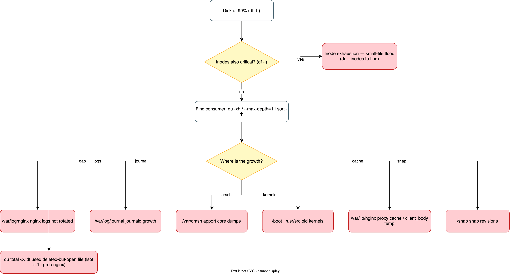

# Problem 2: Diagnose Me Doctor

**Scenario:** Ubuntu 24.04 VM, 64GB disk, running only NGINX as a load
balancer in front of upstream services. Monitoring reports 99% storage
usage.


## 1. Triage — measure before changing anything

Two different diseases share the "disk full" symptom, so triage first:

```bash
df -h /            # space usage — 99%?
df -i /            # inode usage — critical too?
du -xh / --max-depth=1 2>/dev/null | sort -rh | head -20   # who consumes it?
```

Three distinct states decide the whole investigation:

| State | Meaning |
|---|---|
| `df` high, `du` accounts for it | A real file tree is growing — find it and stop it |
| `df` high, `du` low ("the gap") | A process holds a deleted file open — classic after log rotation without reopen |
| `df -i` critical while space is fine | Inode exhaustion — flood of small files |

> **Immediate mitigation (safe on any root cause):** free space *now* so
> the box stays alive while you find the truth — truncate the largest log
> (`: > /var/log/nginx/access.log`), then investigate. Never delete an open
> log; truncation keeps the inode valid while the process writes.

## 2. Decision tree



## 3. Root causes, impacts, recovery, prevention

### 3.1 nginx logs not rotated (most likely)

- **Confirm:** `ls -lh /var/log/nginx/`; `cat /etc/logrotate.d/nginx` (missing
  or wrong glob); `grep nginx /var/lib/logrotate/status`.
- **Impact:** access/error log grows to 100% of disk → nginx can't append →
  request logging breaks (misleading 5xx visibility), then system services
  (systemd/journald, sshd) degrade and apt/dpkg start failing — traffic
  *routing* keeps working until buffers fail, which is why this sneaks up.
- **Recovery:** truncate (`: > access.log`) for immediate relief; install the
  logrotate config (size+rotate+compress), force one rotation with
  `logrotate -f /etc/logrotate.d/nginx`, then `systemctl reload nginx` so the
  reopen signal takes effect.
- **Prevention:** logrotate with `size 100M, rotate 7, compress` +
  `postrotate: nginx -s reopen` (or `systemctl kill -s USR1 nginx`); ship logs
  off-box (CloudWatch Agent / Loki / rsyslog) so local retention can be tiny;
  alert at 70% disk.

### 3.2 Deleted-but-open file (the "gap")

- **Confirm:** `lsof +L1 | grep nginx` (files with link count 0 still open) —
  usually a rotated log that nginx never got the `USR1` reopen for.
- **Impact:** writes go to an orphaned inode; disk never recovers no matter
  what you delete; symptoms identical to 3.1 but invisible to `du`.
- **Recovery:** `systemctl reload nginx` (or `nginx -s reopen`) — the daemon
  closes the old inode and the space returns instantly. Never restart blindly
  first: a reload is enough and keeps connections alive.
- **Prevention:** correct `postrotate` signal in logrotate (the root cause of
  most "gap" incidents); verify after rotation with `lsof +L1`.

### 3.3 journald growth

- **Confirm:** `journalctl --disk-usage`.
- **Impact:** journal eats the disk slowly; system logging stalls at 100%.
- **Recovery:** `journalctl --vacuum-size=500M`.
- **Prevention:** `/etc/systemd/journald.conf` with `SystemMaxUse=1G`;
  forward to remote syslog and keep local retention short.

### 3.4 Old kernels accumulate

- **Confirm:** `dpkg -l 'linux-image-*' | grep ^ii | wc -l`;
  `df -h /boot` near full.
- **Impact:** `/boot` fills → `apt upgrade` fails mid-kernel-install →
  half-configured packages; usually coexists with unattended-upgrades.
- **Recovery:** `apt autoremove --purge` (keep current + one previous kernel).
- **Prevention:** enable `Unattended-Upgrade::Remove-Unused-Kernels` or a
  weekly autoremove cron; alert on `/boot` usage.

### 3.5 apport crash dumps

- **Confirm:** `ls -lh /var/crash/`.
- **Impact:** a crashing worker (or unrelated process) leaves multi-hundred-MB
  core dumps; disk fills fast.
- **Recovery:** remove old `.crash` files; `systemctl disable apport` if core
  analysis isn't used.
- **Prevention:** keep apport on (it's your post-mortem evidence) but cap
  retention with a cleanup cron; alert on the `/var/crash` directory size.

### 3.6 nginx proxy cache / client_body temp

- **Confirm:** `du -sh /var/lib/nginx/`; check `proxy_cache_path` (if the LB
  also caches) and `client_body_temp_path` (defaults under /var/lib/nginx).
- **Impact:** large uploads through the LB buffer to disk; an unchecked cache
  fills the volume under normal traffic.
- **Recovery:** `rm -rf /var/lib/nginx/cache/*`; for uploads, set
  `proxy_request_buffering off` (stream to upstream) or point
  `client_body_temp_path` at a dedicated volume.
- **Prevention:** `max_size` on every `proxy_cache_path`; dedicated/capped
  volume for temp files; monitor the directory.

### 3.7 Inode exhaustion

- **Confirm:** `df -i` at 90%+; `du --inodes -xh / | sort -rh | head`.
- **Impact:** new files impossible even with free space — nginx logs stop,
  then everything that touches the filesystem breaks; can look identical to
  a full disk.
- **Recovery:** delete the offending small-file tree (typically session
  files, cache dirs, or a misbehaving app writing temp files).
- **Prevention:** monitor `nodev`/inode metrics alongside space; the
  CloudWatch Agent `disk` metric set includes both.

### 3.8 Snap revisions (Ubuntu-specific)

- **Confirm:** `snap list --all` shows many `disabled` revisions.
- **Impact:** hundreds of MB per package silently retained.
- **Recovery:** `snap refresh` + remove old revisions (or `snap set system
  refresh.retain=2`).
- **Prevention:** `refresh.retain=2` — do it on every Ubuntu 24.04 image.

## 4. Monitoring & alerting to add

- CloudWatch Agent (or Prometheus node_exporter):
  - `disk_used_percent` on `/` → warn 70%, critical 85%.
  - `disk_inodes_used_percent` → warn 80% (catches 3.7).
  - `/var/log` as its own metric dimension when mounted separately.
- Journald/rsyslog shipped off-box so log growth is visible, not just storage.
- A canary: `df` check in the existing healthcheck if this VM is behind one.

## 5. Prevention in production

1. Log rotation with size caps + `USR1` reopen **and** off-box log shipping —
   the #1 root cause is a missing/wrong logrotate config.
2. `/var/log` on its own volume (or LVM slice) so log floods can't take down
   the root filesystem or swap.
3. Disk + inode alerts at 70/85% with a runbook (this document is it).
4. Baseline the box after provisioning (`du` snapshot) so drift is a diff,
   not a mystery.
5. Weekly autoremove (kernels), journald caps, snap retention — all image
   defaults, baked into the base AMI.
