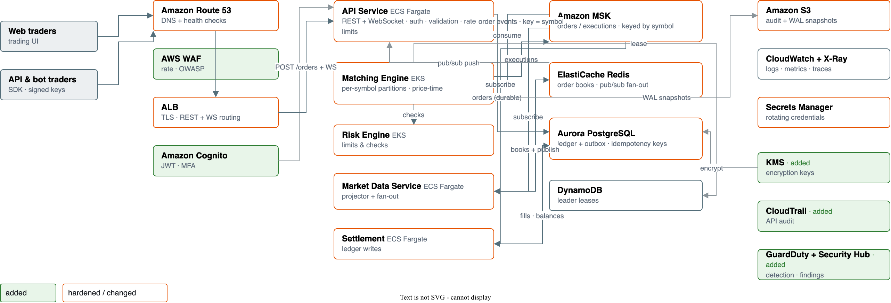

# Problem 5: Fortify The Castle

Security for the Problem 1 trading architecture — integrated into the design,
not bolted on.

## 1. Threat model and design baseline

**Threat model:**
- Internet-exposed retail trading platform; attacker motivations: theft of
  funds/PII, market manipulation, DDoS for ransom or by competitors.
- Trust boundary: nothing outside the VPC is trusted; intra-VPC traffic is
  trusted *at launch* (see §2 and §4 for the mTLS trade-off).

**Design baseline:** SOC 2-type compliance posture; custody out of scope; PII
limited to email and KYC-adjacent account data. These are inputs to the
design — the priorities below are derived from them, and a stricter regime
(e.g. MAS TRM) maps onto this design as configuration and evidence, not as a
redesign.

## 2. Security priorities

### Refuse to ship without
| # | Control | Protects against |
|---|---|---|
| 1 | IAM least-privilege, per-service roles, no long-lived keys | Lateral movement after any single compromise |
| 2 | Secrets Manager with rotation for every credential | Credential exfiltration becoming permanent access |
| 3 | Everything encrypted: TLS in transit everywhere, KMS at rest (EBS/RDS/MSK/S3) | Traffic sniffing, stolen snapshots/disks |
| 4 | Private subnets + per-service security groups (least-privilege ports) | Direct internet exposure of data/compute tiers |
| 5 | AWS WAF + per-user rate limiting on the public API | OWASP top-10, credential stuffing, API abuse |
| 6 | Cognito auth (MFA) with JWT validated by the API Service | Account takeover, unauthenticated trading |
| 7 | CloudTrail (org-wide) + CloudWatch alarms on security events | Undetected compromise |

### Ship in the first hardening sprint
- GuardDuty + Security Hub (managed detection, one pane).
- VPC Flow Logs to S3 (network forensics).
- ECR image scanning via Inspector; signed images in CI (ties into Problem 4).
- Aurora backups with a scheduled restore drill.
- Idempotency keys + request signing for bot API keys (replay protection).

### Deferred (with reasons)
| Control | Why deferred | Trigger to revisit |
|---|---|---|
| App Mesh mTLS between services | High operational cost; intra-VPC assumed trusted at launch | First audit finding, or multi-tenant hosting |
| AWS Shield Advanced | ~$3k/mo, WAF + CloudFront absorb typical floods | Sustained L3/L4 attacks, or when revenue justifies |
| Network Firewall / egress proxy | VPC endpoints cover the known egress; adds a failure point | Unusual egress patterns observed |
| HSM / KMS external key store | Custody-level requirement | If custody enters scope |
| Second-region DR | Cost vs. recovery time accepted | Post-Series-B, or regulatory push |

### Accepted risks (explicit)
1. **Redis has no native KMS.** Accepted with TLS + Redis AUTH + a rule that
   **no PII ever enters the cache** (only prices/order book data). If PII needs
   caching, we move that data to a separate encrypted Aurora table.
2. **CloudFront not in front of the API** (a regional ALB keeps p99 low).
   Accepted with WAF attached to the ALB and a documented migration path if
   the DDoS profile changes.
3. **Single region.** Trading availability in the primary region is the
   product; cross-region DR accepted as a later project.

## 3. What changed and why (security-marked architecture)

### Change-by-change rationale

| Change | What it protects against |
|---|---|
| **WAF attached to the ALB** (managed rules + rate limit per user/IP) | SQLi/XSS via API, credential stuffing, scraping/bot DDoS |
| **Cognito MFA + JWT validated by the API Service** | Account takeover; requests reaching services unauthenticated |
| **Per-service IAM roles, least privilege** (e.g. Order Service can publish to `orders` topic and read/write its Aurora schema — nothing else) | Blast radius of a compromised service |
| **Secrets Manager rotation for PG/Redis/MSK creds** | Long-lived leaked credentials |
| **VPC endpoints for ECR/S3/CloudWatch/Secrets** | Traffic leaving to the internet through NAT; NAT as an exfil path |
| **MSK TLS + SASL/mTLS between services** | Event-stream tampering/sniffing inside the network |
| **KMS on EBS/RDS/MSK/S3** | Stolen disks/snapshots/backups |
| **S3 versioning + SSE-KMS + MFA delete on audit bucket** | Destructive tampering with audit trail |
| **Trading bots: signed API keys + idempotency keys** | Replay attacks, key theft misuse |
| **CloudTrail org-wide + Security Hub** | Post-breach forensics; compliance evidence |
| **Flow Logs** | Detecting unusual east-west traffic (C2, lateral movement) |
| **EKS pod security: restricted PSS, IRSA, no host mounts** | Container escape / node compromise |

## 4. Trade-offs accepted and why they are acceptable

- **Latency vs. TLS:** mutual TLS and JWT validation add < 5ms p99 — inside
  the 100ms budget; measured, not assumed, via X-Ray before launch.
- **Rate limits vs. legitimate bursts:** per-user limits tuned above the
  highest observed legitimate bot throughput; documented escape hatch
  (higher-tier keys) rather than removing the limit.
- **Security Hub costs:** negligible at this scale; the team pays ops
  attention instead of engineering time.
- **No dedicated security team:** controls chosen to be *managed services*
  wherever possible (WAF, GuardDuty, Inspector) so a small team can operate
  them.

## 5. Re-evaluation triggers

These changes re-open the deferred controls above:

- **Custody in scope** → HSM + hardware-backed signing + dedicated security
  review before design freeze.
- **SOC 2 audit** → add Config rules for evidence automation, longer
  CloudTrail retention, formal change management.
- **Sustained DDoS** → CloudFront + Shield Advanced in front of the ALB.
